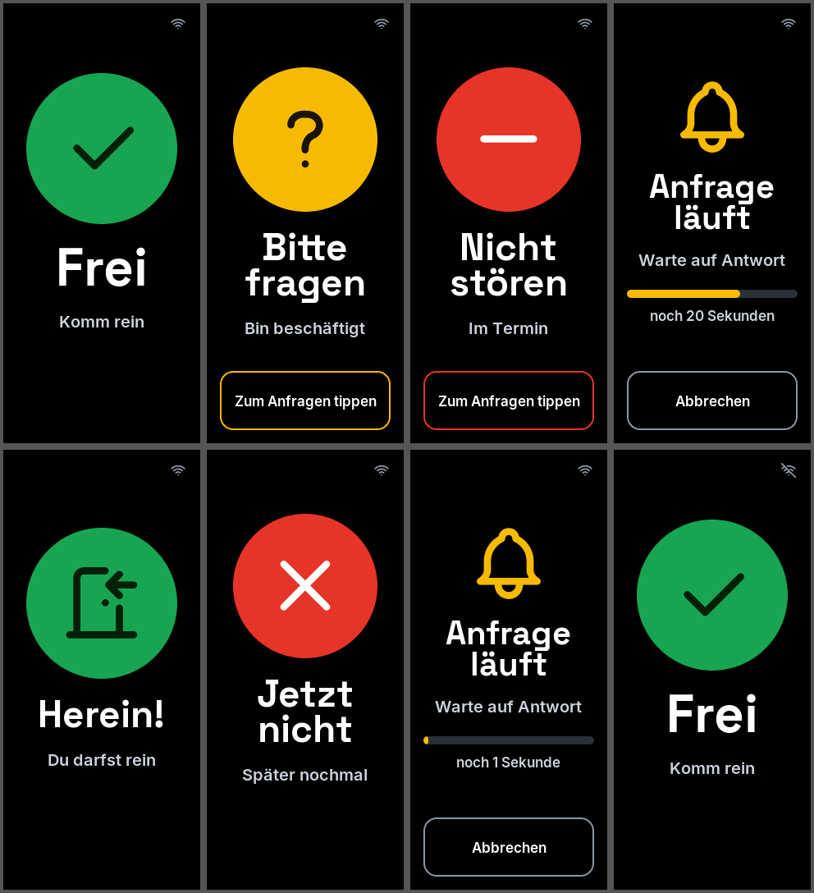
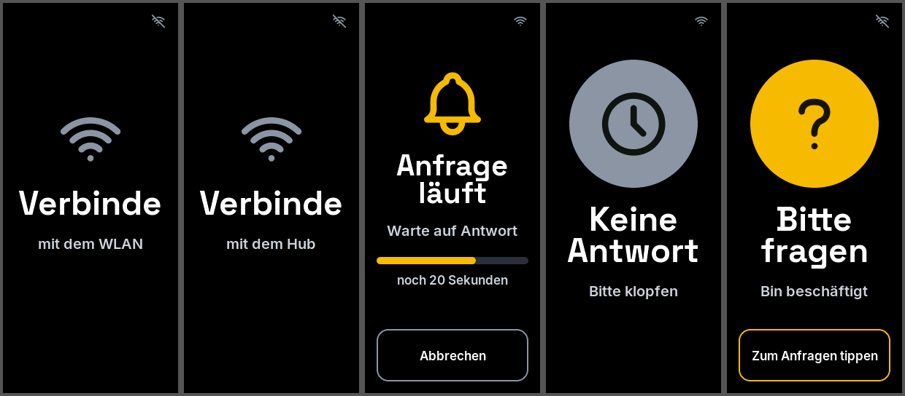

# DigitalDoorLight

Eine Türampel: Ein LILYGO T-Display S3 AMOLED an der Tür zeigt Grün, Gelb oder Rot.
Gesteuert wird es vom iPhone. Wer vor der Tür steht, kann per Tipp auf das Display
anfragen, ob er rein darf.

## Stand

Meilenstein 1 von 8 ist erledigt: Das Display zeigt alle sechs Zustände, noch ohne WLAN und App.
Meilenstein 2 ist erledigt: Der Hub läuft unter
https://tuerampel-hub.chris-otto.workers.dev, die Testseite unter `/test`.
Einrichtung und Betrieb: [hub/README.md](hub/README.md).
Meilenstein 3 ist erledigt: Das Display hängt am Hub und zeigt den Status, den die App
setzt.
Meilenstein 4 und 5 sind gebaut: Die App läuft unter
https://tuerampel-hub.chris-otto.workers.dev auf dem iPhone und im Browser am PC und
beantwortet Anfragen. Der Test am iPhone steht aus.



Das Bild stammt aus einem Rendering des Firmware-Codes am Rechner. Am Gerät
getestet am 15.11.2026: Anzeige, Tipp und Countdown laufen.

Neu in M3: Verbindungsaufbau, laufende Anfrage, keine Antwort und die Anzeige
ohne Verbindung.



| Nr. | Ziel | Stand |
| --- | --- | --- |
| M1 | Display zeigt alle Zustände | erledigt |
| M2 | Cloud-Hub steht | erledigt |
| M3 | Display hängt am Hub | erledigt |
| M4 | iPhone-App steuert die Ampel | gebaut, Test am iPhone offen |
| M5 | Anfrage bei offener App | gebaut, Test am iPhone offen |
| M6 | Push-Mitteilung | offen |
| M7 | Dauerbetrieb an der Tür | offen |
| M8 | Akku als Puffer | offen |

## Hardware

- LILYGO T-Display S3 AMOLED, 1,91 Zoll, 240 x 536 Pixel, Touch-Version
- USB-C-Kabel mit Datenleitung

## Firmware aufspielen

1. [VS Code](https://code.visualstudio.com) installieren, darin die Erweiterung
   "PlatformIO IDE".
2. Dieses Repository klonen und in VS Code den Ordner `firmware` öffnen, nicht das
   Hauptverzeichnis.
3. Im Ordner `firmware/include` die Datei `secrets.example.h` kopieren, die Kopie
   `secrets.h` nennen und darin WLAN-Name, WLAN-Passwort und den Display-Schlüssel
   eintragen. Der Schlüssel ist derselbe wie im GitHub-Secret `HUB_DEVICE_KEY`.
   `secrets.h` kommt nicht ins Repository.
4. Das Board per USB-C anschließen.
5. In der PlatformIO-Leiste unten auf den Pfeil "Upload" klicken. Der erste Lauf
   lädt Compiler und Bibliotheken und dauert einige Minuten.

Auf der Kommandozeile geht dasselbe mit `pio run -t upload` im Ordner `firmware`.

## Was die Firmware tut

- Nach dem Start erscheint "Verbinde mit dem WLAN", dann "mit dem Hub". Sobald der
  Hub antwortet, zeigt das Display den aktuellen Status.
- Ändert die App oder die Testseite den Status, folgt das Display sofort.
- Bei Gelb oder Rot schickt ein Tipp aufs Display eine Anfrage. Der BOOT-Taster auf
  der Platine wirkt wie ein Tipp.
- Während der Anfrage läuft ein Countdown von 30 Sekunden. "Abbrechen" unten bricht
  sie ab, ein Tipp auf den Rest des Displays nicht.
- Die Antwort erscheint als "Herein!" oder "Jetzt nicht", ohne Antwort als
  "Keine Antwort". Nach 6 Sekunden oder einem Tipp kehrt das Display zum Status zurück.
- Ohne Verbindung zeigt das Symbol oben rechts ein durchgestrichenes WLAN, das Feld
  unten sagt "Offline, bitte klopfen". Die Verbindung baut sich von selbst neu auf.

## Wenn etwas nicht klappt

- **Upload findet das Board nicht:** BOOT-Taster gedrückt halten, USB-Kabel
  einstecken, Taster loslassen, Upload wiederholen. Danach das Board einmal neu
  einstecken.
- **Bild steht auf dem Kopf:** In `firmware/include/config.h` den Wert
  `DISPLAY_ROTATION` von 1 auf 3 ändern und neu aufspielen.
- **Display bleibt schwarz:** Den seriellen Monitor in PlatformIO öffnen. Steht dort
  "Display nicht erkannt", hat die Firmware das Board nicht als 1,91-Zoll-Touch-Modell
  erkannt.
- **Zu hell oder zu dunkel:** `DISPLAY_BRIGHTNESS` in derselben Datei, 0 bis 255.
- **Bleibt bei "Verbinde mit dem WLAN":** WLAN-Name und Passwort in `secrets.h`
  prüfen. Der ESP32 kann nur 2,4 GHz, kein 5-GHz-WLAN.
- **Bleibt bei "Verbinde mit dem Hub":** Meist stimmt der Display-Schlüssel nicht.
  Der serielle Monitor zeigt dann wiederholt "[hub] getrennt".
- **Fehler beim Bauen "secrets.h fehlt":** Schritt 3 unter "Firmware aufspielen".

## Aufbau des Repositories

```
firmware/
  platformio.ini        Build-Konfiguration
  boards/               Board-Definition des Herstellers
  include/config.h      Einstellungen: Ausrichtung, Helligkeit, Hub, Fristen
  include/secrets.example.h  Vorlage für WLAN und Display-Schlüssel
  include/lv_conf.h     LVGL-Konfiguration
  src/main.cpp          Start, BOOT-Taster
  src/controller.cpp    Ablauf: Status, Anfrage, Antwort, Offline
  src/hub_client.cpp    WLAN und WebSocket zum Hub
  src/ui.cpp, ui.h      Die Screens
  src/fonts/            Erzeugte Schriften und Icons
  lib/LilyGo_AMOLED/    Display- und Touch-Treiber des Herstellers
  tools/make_fonts.sh   Erzeugt die Schriften neu
hub/
  src/index.ts          Worker: Adressen, Schlüsselprüfung, Testseite
  src/door.ts           Durable Object: Zustand, Fristen, Verteilung
  src/protocol.ts       Nachrichten und ihre Prüfung
  public/               Die App: HTML, JavaScript, CSS, Icons
  test/smoke.mjs        Ablauftest gegen einen lokalen Hub
  README.md             Einrichtung bei Cloudflare
.github/workflows/      Tests und Ausrollen des Hubs
docs/protokoll.md       Nachrichten zwischen Display, Hub und App
docs/                   Bilder
```

Die App liegt in `hub/public`, der Hub liefert sie aus.

## Verwendete Software

| Teil | Lizenz |
| --- | --- |
| [LVGL](https://github.com/lvgl/lvgl) 9.6.0 | MIT |
| [LilyGo-AMOLED-Series](https://github.com/Xinyuan-LilyGO/LilyGo-AMOLED-Series), Kopie in `firmware/lib` | MIT |
| [SensorLib](https://github.com/lewisxhe/SensorLib) 0.5.1 | MIT |
| [arduinoWebSockets](https://github.com/links2004/arduinoWebSockets) 2.7.2 | LGPL 2.1 |
| [ArduinoJson](https://github.com/bblanchon/ArduinoJson) 7.4.3 | MIT |
| Schrift [Space Grotesk](https://github.com/floriankarsten/space-grotesk) | SIL Open Font License 1.1 |
| Schrift [Inter](https://github.com/rsms/inter) | SIL Open Font License 1.1 |
| [Tabler Icons](https://github.com/tabler/tabler-icons) | MIT |
| [Wrangler](https://github.com/cloudflare/workers-sdk) 4.162.0, nur zum Bauen | MIT oder Apache 2.0 |
